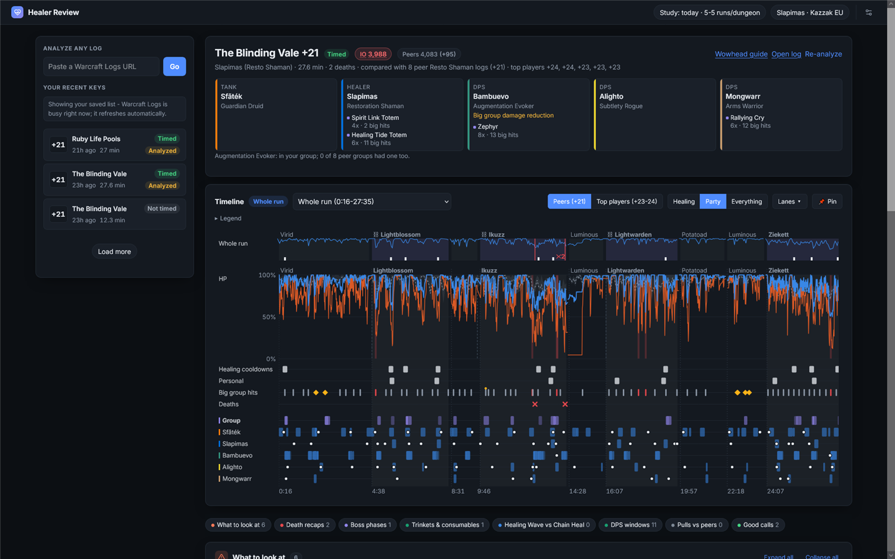

# Healer Review

Mythic+ healing review built on Warcraft Logs: it compares your run with **peers** (the best healers of your spec at
your key level) and **top players** (a season study of top-ranked runs), and only flags moments that mattered.

**Use it online: https://healer-review.onrender.com** - sign in with your Warcraft Logs account. Or run it locally
(below).



Specs: Restoration Shaman, Restoration Druid, Mistweaver Monk, Holy Priest, Preservation Evoker, Holy Paladin,
Discipline Priest.

## Features

**What to look at**
- Findings ranked by how much they mattered, each with a one-line fix and the evidence behind it.
- Review strictness follows the key: farm keys show only what hurt, push keys get the full review (based on your
  best timed key; override in Display).
- Death recaps: what killed the player, what was ready (group / victim / you) and whether it would have saved them.
- Damage spikes judged on **your** cooldowns: held cooldowns, healing overlaps that left the next spike uncovered,
  big hits with a cooldown ready but unused.
- Avoidable damage and missed interrupts, learned from peer logs.
- Boss phases, chain pulls, trinkets & potions, single-target vs group heals, DPS windows (calm time you could have
  spent on damage, with the damage you left on the table).

**Timeline**
- Group HP, lowest player and a Peers / Top players band; switch between them.
- Lanes for your cooldowns, personals, trinkets, big hits, deaths, findings, mana, and one per party member with their
  defensives, potions and trinkets.
- Whole run or one pull; drag to zoom into any range (also across pulls), with a summary of that window.
- Every time on the page is a link that jumps the timeline there; pin it to keep it on screen.
- Hover any ability name for its in-game tooltip (Wowhead).

**Around the run**
- Group composition and what each player brings (Rallying Cry, Zephyr, …).
- Raider.io badge: your group's average score vs peers or top players.
- Recent keys from your character, with your newest ones analyzed in the background.
- Light / dark theme, text size, character picker with your Warcraft Logs characters.

**Built to cope with Warcraft Logs limits**
- Analyses are stored: reopening one is instant and needs no API calls.
- New analyses queue and wait out rate limits instead of failing; your run's timeline shows while the comparison loads.
- Errors show one clear banner with Try again; signed out, public runs still open from a link.

## Run it locally

1. Create a Warcraft Logs API client (https://www.warcraftlogs.com/api/clients) and put its id and secret in `.env`
   (see `.env.example`).
2. Double-click **`start.bat`** (sets up Python on first run) and open http://127.0.0.1:8000.
3. Set your character (top right) and click a key, or paste any log URL.

A first analysis of a dungeon and key level costs ~300 API points (1000/hour); later ones reuse the cached peer logs.

## Top-player study

The season study (per spec, ~5 top runs per dungeon) powers planned cooldown timings, cooldown rate, HoT prep and the
Top players band. To refresh it locally:

```
.\.venv\Scripts\python study.py --spec resto_shaman --runs 5
```

It pauses for the hourly API reset when the budget runs low (~520 points per spec). Included for all seven specs.

## For developers

- Findings and thresholds: `app/findings.py`, `app/context.py`. Analysis pipeline: `app/pipeline.py`.
- Specs: one module per spec in `app/specs/` (cooldowns, maintenance HoT, heal pair, tracked buffs). Add a module and
  list it in `app/specs/__init__.py`.
- Editable data: `data/defensives.json` (defensive values), `data/comp_effects.json` (what specs bring),
  `data/encounters.json` (our ability notes), `data/realms.json` (realm autocomplete).
- Command line: `.\.venv\Scripts\python cli.py analyze "<report url>" [--player NAME] [--fresh]`.

## Known limits

- Cooldowns never cast in a run are treated as not talented.
- Raider.io scores are players' current-season scores, not their scores at the time of the run.
- The top-player band uses HP after each hit (the study skips healing events), so it runs slightly low.

## License

MIT - see `LICENSE`.
